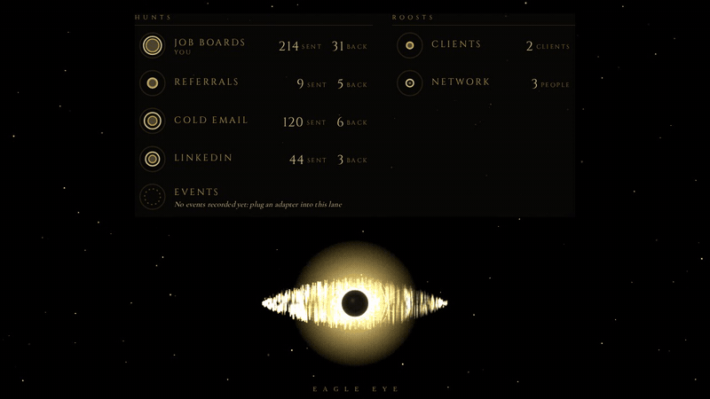
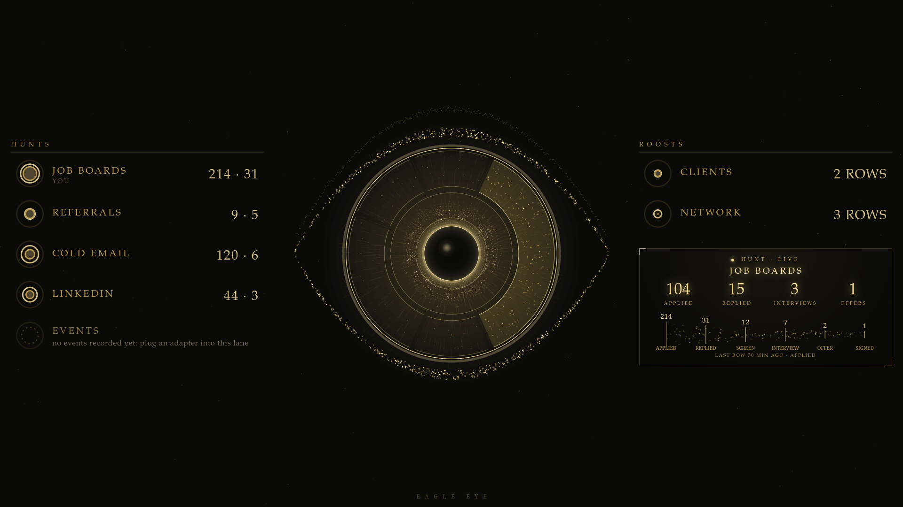
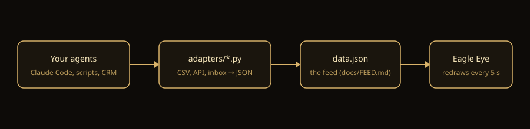

# Eagle Eye



## The #1 Open-Source Networking Machine

The open alternative to Apollo and Clay, designed for AI agents. Eagle Eye puts your whole
network on one screen: what you send out sits on the outer ring (**hunts**: applications, proposals, cold email, posts), and what came
back sits on the inner ring (**roosts**: replies, clients, your network). It reads one JSON feed and redraws every 5
seconds, on a phone, a laptop or a wall.

```bash
curl -fsSL eagleeye.sh/install | sh
```

That downloads Eagle Eye into `./eagle-eye` and serves the demo on http://localhost:8000. Site: [eagleeye.sh](https://eagleeye.sh). Docs: [eagleeye.sh/docs](https://eagleeye.sh/docs).
Live demo: [eagleeye.sh/demo](https://eagleeye.sh/demo/). Want it run for you, server and agents included?
[See what's included](https://services.utopiamodels.ai/#eagle-eye).

It fits whatever screen it is on, with no scroll bar: a phone, a laptop, a 1080p wall, an ultrawide, or half of a
desk. At every size HUNTS and ROOSTS sit side by side on top, and the eye takes the room below them.



## How it fits together



## Run it on the demo feed

No build, no dependencies, no account. The one-liner above, or by hand:

```bash
git clone https://github.com/utopia-models/eagle-eye && cd eagle-eye
python3 -m http.server 8000      # or: npx serve .
# open http://localhost:8000
```

Everything you see comes from `demo/data.json`, which is made-up sample data. Every campaign, person and step has its own page at `/campaigns.html`, fed by `demo/campaigns.json` (also made up).

## Plug in your agents

Give each agent a lane. Have it append one row per action (applied, replied, interview, ...) to a CSV ledger, or
write the feed JSON directly.

1. Write a feed in the shape in [`docs/FEED.md`](docs/FEED.md). The reference adapter turns a CSV ledger (one row per
   application or status change) into a feed:
   ```bash
   python3 adapters/csv_feed.py my-ledger.csv > data.json
   ```
2. Point `feed` in [`config.js`](config.js) at it, and name your lanes in `pipes`.
3. Re-run the adapter on a schedule (cron, a systemd timer, a serverless function). The page picks up changes
   within 5 seconds, with no reload.

Any adapter that writes the same JSON works: a CRM export, an ATS API, an inbox count.

## The landing page

`site/` is the static page served at [eagleeye.sh](https://eagleeye.sh) (Vercel, root directory `site`). `install.sh`
is served at `eagleeye.sh/install`.

## Check the layout

```bash
npm i && npx playwright install chromium webkit firefox
python3 -m http.server 8000 &
npm run check     # 6 sizes x 3 browsers: fails on any overlap, anything off screen, or a scroll bar
```

## Where it comes from

Eagle Eye is the screen Utopia Models watches its own fleet of Claude Code agents on, released with the UI and a
demo feed only. No real data and no credentials ship in this repository.

Licensed under the [MIT License](LICENSE). Made by [Utopia Models, Inc.](https://utopiamodels.ai)
