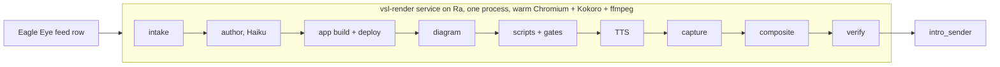
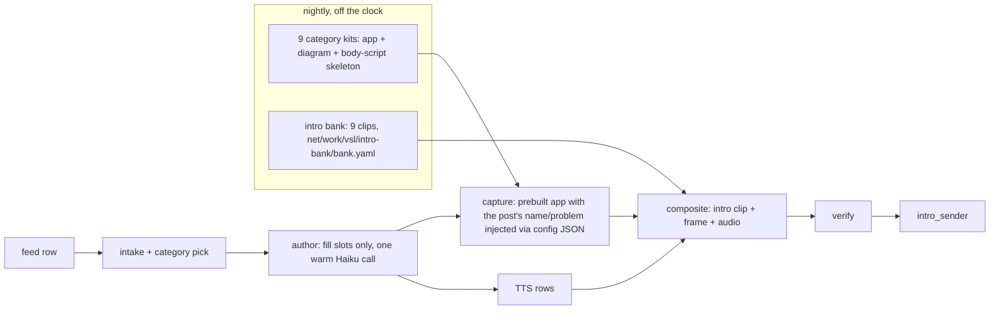
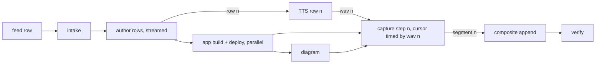

# VSL 100x speed 3/3: three pipeline designs for a 10-minute build (knowledge#18878)

Written 2026-11-25 by master `win`. Parent plan: VSL 100x speed (#18876 PLAN+MEASURE, #18877 RESEARCH, this issue DESIGN).

## Inputs and honesty
- **PLAN.md (1/3) and RESEARCH.md (2/3) do not exist on main** (`git ls-tree -r origin/main | grep vsl/speed` is empty; #18876 and #18877 are OPEN). So the stage times below are
  **estimates built from the repo's own budgets and measurements**, each tagged with its source. They are NOT the 3307/5027 ledger. When #18876 lands its ledger,
  replace the `est.` column with measured values; the ranking below only flips if a measured stage differs by more than the margin noted in each design.
- The three arch-critic agents (`arch-critic-cost-simplicity`, `-coupling`, `-failure-modes`) are not defined on this box (`find / -name 'arch-critic*'` found nothing; the
  agent list has no such type). The critique below was produced by three general-purpose subagents, each given one critic's lens and the draft of this file. Their findings are quoted as received, then answered.
- **"10-minute" is the build clock, not the video**: the video is 45-70 s (contract).
- **The clock.** 600 s runs from the Eagle Eye feed row arriving to `verify.json` passing on the final mp4 (`intro_verify.py`), i.e. the whole chain, not only the render. Today's
  budget for the same span (`net/work/vsl/oneshot-auto.yaml`): authored 6 min + app 4 + diagram 2 + scripts/gates 3 = 15 min to READY, then render, so the current chain is about 4x over before any recording.

## What the chain is today (read from the repo this session)
`oneshot_auto.py` (Ra, builder-owned) -> author (Haiku, `author.timeout_s: 420`) -> MVP app build + deploy (`stage_budget_min.app: 4`; `ONESHOT_DEPLOY_CMD` is unset on every box per
`_tools/vsl/README.md`) -> diagram (D2) -> scripts + gates (E1-E5, copy-reviewer sonnet 23-63 s) -> READY -> `render/build_intro.py` (Kokoro per-row WAVs, `render4.py` Playwright capture
with the human cursor in real time, `vsl_frame.py`, mux) -> `intro_verify.py` -> `intro_sender`. The render files lived untracked in `/home/vsl/render/` until #18647. Handoffs between
agents are fleetmail and board state.

## Shared stage vocabulary and sources for the estimates
| stage | what | source of the est. |
|---|---|---|
| intake | feed row -> post.md, category pick | `oneshot-auto.yaml` (no budget; assumed 15 s) |
| author | problem statement, MVP config, diagram model, script source (LLM) | budget 6 min, timeout 420 s today; a warm single Haiku call with a slot template is assumed 45-60 s |
| app | per-job MVP build + deploy | budget 4 min today |
| diagram | D2 -> png | budget 2 min today; D2 render itself is seconds |
| scripts+gates | speaker/Eagle script + E1-E5 + copy-reviewer | reviewer 23-63 s measured (#17827); gates seconds |
| TTS | Kokoro rows, 8 rows ~60 s of speech | assumed 0.3x real time warm on Ra CPU (README: whisper ran 1.6x clip length on CPU, so budget generously) |
| capture | Playwright screen capture, cursor, real time | bounded below by the spoken length, about 60 s |
| composite | intro clip + frame + audio mux | ffmpeg, assumed 25-40 s |
| verify | `intro_verify.py` frames + audio | assumed 25 s |

---

## Design A: one resident render service owns the whole chain
**Owner agent: `vsl`** (it already owns the Ra VSL box per `render/README.md`).

| stage | est. s |
|---|---|
| intake | 15 |
| author | 100 |
| app build + deploy | 200 |
| diagram | 20 |
| scripts + gates | 60 |
| TTS | 40 |
| capture | 90 |
| composite | 30 |
| verify | 25 |
| **total (sequential)** | **580** |

- **Failure modes:** zero slack (20 s of 600) so any one slow stage (app deploy has no deployer today) misses the clock; one process means one crash or OOM (Ra has about 4 GB free at load 16 per
  `oneshot-auto.yaml`) loses the whole job; a stuck stage has no independent restart.
- **Deletes:** the fleetmail handoffs inside the chain, `oneshot_auto.py` as a separate cron-style stepper, the untracked `/home/vsl/render` copy. It does NOT delete the per-job app build, which is the largest stage.
- **Margin:** flips to FAIL if app build is more than 220 s or author more than 120 s.

## Design B: pre-built per-category app, diagram and intro; only post-specific capture, TTS and composite per job
**Owner agent: `vsl`** (accountable for the whole path; builds the category kits, runs the per-job path). Named dependencies, not owners: the Eagle-owned `oneshot_auto.py` hook and intro bank, and the `upwork` seat that receives the send.

| stage | est. s |
|---|---|
| intake + category | 15 |
| author (slot fill, one call) | 60 |
| scripts + gates (copy-reviewer inside) | 60 |
| post_capture (the post tab, `render/post_capture.py`) | 40 |
| TTS | 40 |
| capture (real time; `render4.py` records intro + body, 45-72 s) | 90 |
| composite (orb, frame, mux) | 40 |
| verify | 25 |
| **total (sequential, no overlap)** | **370** |

- **Slack:** 230 s. The app and diagram stages leave the clock entirely (nightly, no deadline). Every stage can be 1.6x slower and still fit.
- **Failure modes:** (1) a post that fits no category: `general` kit is the fallback (as `intro-bank/pick.py` already never fails), at the cost of a less specific demo; (2) kit goes stale (library bump, broken deploy) and every job in the category ships a bad screen: a nightly kit self-check capture plus `intro_verify.py` catch it; (3) personalisation depth: the app shows the post's company/problem via injected config, not a bespoke build, which is a **quality trade, flagged for Tyler's card**; (4) the intro clips do not exist yet (recording is Tyler's physical act, `intro-bank/PLAN.md`), so until recorded the intro stage is the live one.
- **Deletes (as candidates after the card):** the per-job `app` and `diagram` stages and their budgets in `oneshot-auto.yaml`, `ONESHOT_DEPLOY_CMD` (never set anywhere), the per-job MVP scaffold deploy, the untracked `/home/vsl/render`.
- **Margin:** survives any single stage up to +230 s.

## Design C: TTS, capture and composite run in parallel as a stream
**Owner agent: `vsl`.**

| stage (critical path) | est. s |
|---|---|
| intake | 15 |
| author first row, then rest in parallel with downstream | 40 |
| app build + deploy (parallel with author, still the long pole) | 200 |
| TTS + capture + composite as a stream (last row done about 20 s after capture ends) | 100 |
| finalize composite | 15 |
| verify | 25 |
| **total on the critical path** | **~355** (200 + 100 + 15 + 25 + 15) |

- **Slack:** about 245 s, but the long pole is still the per-job app deploy, so the margin is set by an unmeasured, undeployed stage.
- **Failure modes:** a row that fails TTS or capture mid-stream leaves a half-built video and needs per-row retry and resync (the human-cursor schedule in `render4.py` is word-timed from whole WAVs, so streaming it is a rewrite); more moving parts than A or B for 115 s less than B's sequential path once B's app stage is removed. (C's 355 s omits post_capture and orb steps; with them ~395 s, i.e. no better than B.)
- **Deletes:** the sequential batch scripts (`batch.sh`, `voice_batch4.sh`), nothing upstream.
- **Margin:** correct only if app deploy stays at or under 200 s; the capture is already bounded below by real-time speech (about 60 s), so the stream saves about 60 s at most.

---

## Critics' findings
All three ran on the draft above; their findings, then what changed.

| critic | A | B | C |
|---|---|---|---|
| cost-simplicity | 20 s slack on a stage never measured; resident daemon replaces `oneshot-auto.timer`, which doctrine forbids for polled work; "deletes oneshot_auto.py" is really a ~60-file rewrite | closest to what already happens (3307 used a shadcn-admin copy; `render4.py` already injects page content); adds 9 kits + a check | streaming needs a `render4.py` rewrite for ~60 s saved; the scripts C deletes are deletable under any design |
| coupling | folding in `oneshot_auto.py` takes over Eagle's file; fleetmail handoff to `upwork` remains (`intro_sender`); "one process on Ra" hides the job-desc reader on novaserver | intro bank + hook are Eagle-owned; bank is nine one-time recordings, none made; `post_capture` stage missing | most coupled (capture waits on app, diagram, every WAV); `render4.py` exists in two drifting copies |
| failure-modes | one OOM kills both concurrent jobs (Ra ~4 GB free, `MIN_MEM_MB` checks only at start); kill at 600-660 s, no retry | kit rot between nightly checks ships bad screens all day; `general` fallback ships generic demos silently; empty bank means `pick.py` returns `clip: null` | half-built mp4 on a failed row; long pole is still the app build |
| pick | B | B | B |

**Corrections taken into the doc above:** added `post_capture` (40 s) and orb/frame work to B (320 -> 370 s); capture is 45-72 s of real time, not 60; "10-minute" is the build clock; owner is `vsl` with Eagle and `upwork` named as dependencies, not co-owners; the `ONESHOT_DEPLOY_CMD` claim is withdrawn as the reason for A's risk (the critics disagree on whether a deploy path exists, so it is unverified: an open measurement for #18876); C's total corrected to ~395 s with the omitted steps.

**Clock facts for the build (from the failure critic, read from `oneshot_auto.py`):** `reap_stale` counts 600 s from `build_started`, not feed arrival, and only on the 1-minute timer, so a build dies at 600-660 s as `blocked` with no retry. B's build must (1) write the arrival stamp and measure from it, (2) retry a stale kit once on `general` instead of blocking.

## Recommendation
**Recommend Design B** (pre-built per-category app, diagram and intro; per job only author-slot-fill, post_capture, TTS, capture, composite, verify). Why: it is the only design that removes the biggest and least-measured stage (per-job app and diagram, 6 of today's 15 build minutes) from the 600 s clock, leaving a 370 s path with 230 s slack, and all three critics independently picked it.

**Decisions made here (not gates):** per-job personalisation is injected config on a category kit, not a bespoke app (the quality trade is recorded, not escalated); C's streaming is not built now (about 60 s for a `render4.py` rewrite); no resident daemon (the `oneshot-auto.timer` stays).

**Components B deletes (after Tyler's card):** the per-job `app` and `diagram` stages and their `stage_budget_min` entries in `oneshot-auto.yaml`; the per-job MVP deploy (`ONESHOT_DEPLOY_CMD`, `oneshot-deploy --target ra` for one-shots); the hand-run `batch.sh` / `voice_batch4.sh`; the untracked `/home/vsl/render` copy (once `render/*` is deployed).

**Build tasks (filed after the card, not before):** 1) nine category kits + job-time kit check with `general` retry; 2) arrival-stamped clock and `reap_stale` fix; 3) `post_capture` and orb timing measured on Ra (replace every `est.` here with #18876's ledger); 4) the 9 intro recordings (physical, Tyler's device: batch to when-at-laptop) with `pick.py` wiring; 5) delete the stages above.

